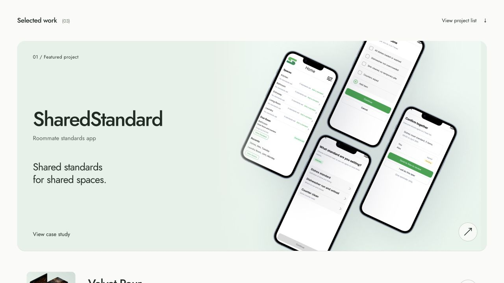
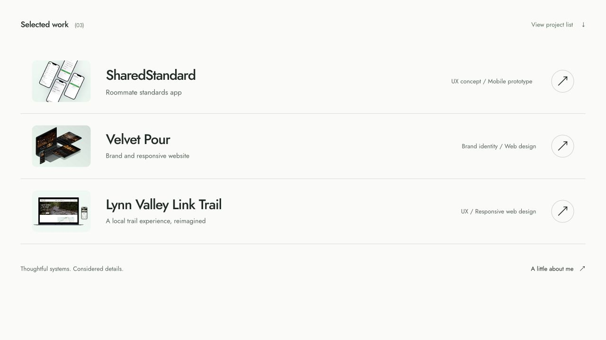
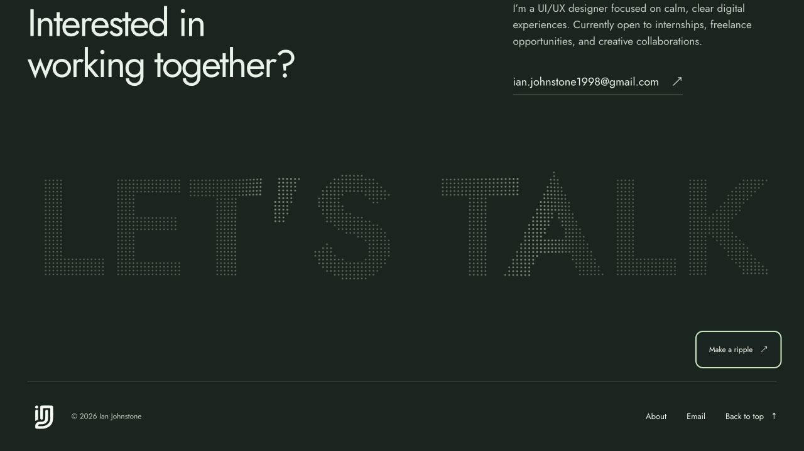

# Homepage interaction preview

A separate homepage experiment for Ian Johnstone. It preserves the existing mint hero, monogram, Jost typography and rotating introduction, then adds a cursor-following light field, a featured project that contracts into the work list, and an interactive dot-lettering footer.

This directory is for review. The production homepage, styles, case studies, domain and deployment configuration are unchanged. The branch is `codex/practicum-homepage-preview` and should stay unmerged until the design has been reviewed.

## Open the preview

[Open the interactive branch preview](https://htmlpreview.github.io/?https://github.com/ianjohnstone4/portfolio-for-creatives/blob/codex/practicum-homepage-preview/previews/practicum-2/index.html). This uses GitHub HTML Preview to render the files from this branch and does not deploy to ianjohnstone.ca. Allow a moment for the stylesheet and script to load.

To run it locally instead:

From the repository root:

```sh
python3 -m http.server 8766 --bind 127.0.0.1
```

Open <http://127.0.0.1:8766/previews/practicum-2/>. For Desktop, Tablet and Mobile review controls, open <http://127.0.0.1:8766/previews/practicum-2/review.html>.

There is no build step or package installation. `index.html` can also be opened directly from a downloaded repository, with the existing `assets` directory in place.

## Try these interactions

1. Move the pointer around the hero. The pale green light field follows with a gentle delay.
2. Scroll into Selected work. SharedStandard starts as a large feature and contracts into the first project row. Scrolling back reverses the transition. The View project list button skips to the completed list.
3. Move over or click the footer lettering. The dots respond and settle back into place. Make a ripple also works with a tap or keyboard activation.
4. Use the motion control beside About. It pauses the rotating introduction and decorative effects, and replaces the sticky scroll sequence with a normal-flow layout. The choice persists locally.

Phones and short windows use normal scrolling with a large feature above the project rows. System reduced-motion preferences select the static layout by default. Without JavaScript, the projects, navigation and contact links remain available.

## Review images

### Featured project


### Collapsed project list


### Interactive footer


## Files and sources

- `index.html`: preview markup, project links and existing portfolio content.
- `preview.css`: isolated responsive styles and rotating text animation.
- `preview.js`: native-scroll transition, pointer-following gradient, motion control and canvas dots. No animation library, scroll interception, analytics or remote write operations.
- `review.html`: optional local device-width review wrapper.
- `captures/`: browser screenshots of the implemented preview.

Project images and the monogram are reused from this repository. Jost is loaded from Google Fonts, as on the current site. The featured project uses `assets/temp/p-one-hero.jpg`, the existing SharedStandard prototype mockup. Case-study and About links point to the current public pages. The existing Instagram link still points to the Instagram homepage and needs the correct profile URL before any production release.

Interaction references from the supplied inspiration document: [Onda Studio](https://www.ondastudio.co/) for the large-to-compact scroll idea and [Opal](https://op.al/) for cursor-responsive footer lettering. The canvas lettering and interaction code are original to this preview; no reference-site assets or code were copied. The repository's existing [license](../../LICENSE) remains applicable.

## Validation

- JavaScript syntax check passed.
- Local asset and anchor references checked.
- Browser review at 1280 × 720 and embedded widths of 834 and 390 pixels.
- Checked the full, intermediate and collapsed project states; hero pointer movement; footer ripple activation; project keyboard focus; motion pause, persistence after reload, and resume.
- No console warnings or errors during the desktop review.
- Verified the remote GitHub HTML Preview loads all project images and scripts and reaches the collapsed project-list state.
- Confirmed that production files match the original `main` commit.

System reduced-motion and no-JavaScript fallbacks were reviewed in the source. The manual motion-off path was exercised in the browser. Native phone hardware and a full cross-browser/accessibility audit are outside this preview's validation.
